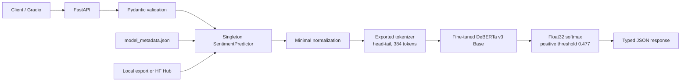

# Production-Ready Transformer Sentiment Analysis

A notebook-trained IMDB classifier refactored into a typed, tested, and
container-ready ML inference service. The project preserves the selected
Transformer's preprocessing and decision rule while separating research code,
model artifacts, and production serving.

> [!IMPORTANT]
> The fine-tuned model is bundled into the Docker image. Its immutable source,
> filenames, sizes, and SHA-256 hashes are tracked in
> [`model/manifest.json`](model/manifest.json). Large weights stay out of Git.
> Docker downloads and verifies the complete snapshot during the first build;
> subsequent container starts use the bundled files offline.

## Run with one command (PowerShell or CMD)

Install and start Docker Desktop with Linux containers. Download this repository
or clone it, then open PowerShell or CMD in its root folder:

```console
git clone https://github.com/RetajMelhem/imdb-sentiment-api.git
cd imdb-sentiment-api
```

Start the API, including the real fine-tuned model (PowerShell or CMD):

```console
.\start.cmd
```

Open **<http://localhost:8080/docs>** to enter reviews and try predictions.
The launcher builds the CUDA-capable image, probes GPU access through Docker,
and prioritizes an available NVIDIA GPU. Otherwise the model loads on CPU and
system RAM. `/health` reports the selected device. The first build needs internet
for Python/CUDA packages and about 749 MB of model files. Allow several minutes,
at least 4 GB available Docker memory, and about 20 GB free disk for building.
No host Python, Hugging Face token, `.env`, or separate model download is needed.

For the Windows release ZIP, extract the complete bundle and run `start.cmd`
from CMD or `.\start.cmd` from PowerShell. The launcher imports the included
Docker image, starts the API, and waits for health. The starter ZIP downloads
checksum-verified image parts on first use. For an offline install, download all
`.tar.partNNN` assets beside the extracted launcher first.
See [release notes](RELEASE_NOTES.md).

## Highlights

- Screened five Transformer backbones on a controlled IMDB development split:
  DeBERTa v3 Base, DeBERTa v3 Small, RoBERTa Base, DistilRoBERTa, and ELECTRA
  Base.
- Selected `microsoft/deberta-v3-base`, then ran validation-only Optuna tuning
  and final training with seed 42.
- Preserves the notebook's minimal text normalization and exact tokenizer IDs,
  head–tail truncation, dynamic padding, float32 softmax, and optimized positive
  threshold.
- Loads the tokenizer and model once during FastAPI lifespan startup, supports
  CPU/CUDA, and performs real batched inference under `torch.inference_mode()`.
- Includes strict Pydantic contracts, deterministic unit/API tests, Docker,
  GitHub Actions, an artifact export/parity workflow, and an optional Gradio UI.

## Notebook audit: serving contract

The executed notebook at [`notebooks/model_training.ipynb`](notebooks/model_training.ipynb)
is the experiment record. Its serving-relevant facts are centralized in
[`model_metadata.json`](model_metadata.json):

| Setting | Audited value |
|---|---|
| Winning backbone | `microsoft/deberta-v3-base` |
| Selected final run | `single_seed_42` (weight `1.0`, no TTA) |
| Tokenizer | notebook requested `use_fast=false`; exported checkpoint vocabulary |
| Labels | `0 = negative`, `1 = positive` |
| Positive class | ID `1` |
| Preprocessing | `minimal_normalize_v1` |
| Truncation | balanced head–tail, maximum 384 tokens including special tokens |
| Padding | dynamic per batch, padded to a multiple of 8 |
| Probability | two-logit float32 softmax; index 1 is positive |
| Decision rule | positive when `P(positive) >= 0.477` |
| Default inference batch size | 8 |

`minimal_normalize_v1` HTML-unescapes the input, replaces case-insensitive
`<br>`/`<br />` tags with spaces, removes ASCII control characters, collapses
whitespace, and strips the result. It deliberately preserves case, punctuation,
and ordinary HTML text so serving matches training.

Training, screening, HPO, evaluation, plotting, and dataset preparation remain
in the notebook; none are imported by the serving package. The production code
does not depend on Colab or Google Drive paths. The preserved executed notebook
intentionally retains its original Colab/Drive outputs as experiment evidence.

## Verified results

These are the notebook's locked, one-time IMDB test-set results over 25,000
examples. They are reporting artifacts—not claims about the un-fine-tuned base
checkpoint.

| Metric | Test result |
|---|---:|
| Accuracy | 0.960880 |
| Precision (positive) | 0.950712 |
| Recall (positive) | 0.972160 |
| F1 (positive) | 0.961316 |
| Macro F1 | 0.960875 |
| ROC AUC | 0.992435 |
| Log loss | 0.130604 |

Confusion matrix, with rows as true labels and columns as predictions:
`[[11870, 630], [348, 12152]]`. Model and threshold selection used validation
data; the test split was reserved for final reporting.

### Real-model verification

The recovered seed-42 safetensors file is byte-identical to the hash recorded by
the notebook run (`e84d2037...47ddd`). Local CPU verification loaded the actual
184,423,682-parameter model and checked five representative cases: short
positive, short negative, HTML/entity normalization, long in-budget text, and
text exceeding 384 tokens. Production and the independently implemented
notebook inference path had maximum absolute logit and probability differences
of `0` in the same runtime. The two probabilities printed by the notebook agree
within `3.84719848645e-07`, below their six-decimal display precision.

The recovered 2,481-row validation prediction artifact also reproduces the
saved final-seed validation metrics. It contains probabilities and labels but
not raw texts/logits, so it is used as metric/provenance evidence rather than a
per-text numerical oracle for the original T4 FP16 runtime.

The retained modern serving stack—CPU Torch `2.13.0+cpu`, Transformers
`5.14.1`, and SentencePiece `0.2.2`—passed these checks without a compatibility
pin to the older notebook libraries. The CPU Docker image was also exercised
with `./model` mounted read-only: it ran as UID 999, reported healthy, loaded
the model once, served single and batched predictions, and matched the local
positive probability with an absolute difference of `0`.

The controlled one-epoch screening stage used 1,500 training and 500 validation
examples at 192 tokens:

| Candidate | Accuracy | F1 | Log loss |
|---|---:|---:|---:|
| `microsoft/deberta-v3-base` | **0.916** | **0.915663** | **0.241611** |
| `microsoft/deberta-v3-small` | 0.886 | 0.885312 | 0.297566 |
| `FacebookAI/roberta-base` | 0.884 | 0.884462 | 0.305849 |
| `google/electra-base-discriminator` | 0.878 | 0.878728 | 0.355632 |
| `distilroberta-base` | 0.858 | 0.852391 | 0.351504 |

## Architecture



## Repository layout

```text
imdb-sentiment-api/
├── app/                    # FastAPI application and lifespan wiring
├── demo/                   # Optional Gradio interface
├── notebooks/              # Original executed experimentation notebook
├── scripts/                # Export, parity, and production smoke checks
├── src/sentiment/          # Config, preprocessing, predictor, schemas, metadata
├── tests/                  # Lightweight unit and API tests; no model download
├── model/manifest.json     # Pinned model source and per-file SHA-256 hashes
├── model_metadata.json     # Audited inference contract and reported metrics
├── Dockerfile
├── docker-compose.yml
└── pyproject.toml
```

## Model artifact (Python development and training)

Docker prepares its own model during the build. To import the same snapshot
into `./model` for Python development, run:

```console
python scripts/download_model.py
```

This uses only Python 3.11+ and resumes by skipping files with matching hashes.
The manifest remains tracked in Git; downloaded files are ignored. Verify an
existing copy without downloading anything:

```console
python scripts/download_model.py --verify-only
```

### Export the notebook checkpoint

Point `--source` at the **fine-tuned checkpoint directory** produced by the
notebook. It must contain a trained sequence-classification model and its
tokenizer, not merely the Hugging Face base-model cache.

```bash
python scripts/export_model.py --source <checkpoint> --output models/custom
```

To choose the metadata file explicitly, or replace a previously exported
directory after reviewing the target, use:

```bash
python scripts/export_model.py \
  --source <checkpoint> \
  --output models/custom \
  --metadata model_metadata.json \
  --force
```

The export writes standard `save_pretrained` artifacts and carries the serving
metadata with them. Large weights are gitignored; `model/manifest.json` is tracked.
Export custom checkpoints to a different directory to preserve the pinned
production snapshot in `model/`. For a custom export, pass
`--model-path models/custom` to the parity check below.

### Verify export parity

Run the parity gate before serving or publishing the artifact:

```bash
python scripts/verify_parity.py --model-path ./model
```

The gate checks exact input IDs, attention masks, in-budget and overflow
head-tail behavior, logits, both probabilities, confidence, thresholding, and
labels. It independently reproduces notebook normalization/encoding and checks
the notebook's displayed probabilities. Secure Transformers 5 releases may
expose the native DeBERTa backend even when the historical `use_fast=false`
argument is supplied; equivalence is therefore established from token IDs and
outputs rather than that mutable implementation flag.

The default absolute tolerance is `1e-6`; it can be stated explicitly:

```bash
python scripts/verify_parity.py --model-path ./model --atol 1e-6
```

If the recovered final-seed `validation_predictions.npz` is available, validate
its shape, domain, and exact recorded metrics in the same run:

```bash
python scripts/verify_parity.py \
  --model-path ./model \
  --validation-predictions /path/to/validation_predictions.npz
```

Do not publish an export that fails parity. Then exercise the same production
predictor used by the API:

```bash
python scripts/smoke_test.py
```

## Local development

Python 3.11–3.13 is supported. Clone the repository and enter its root:

```bash
git clone https://github.com/RetajMelhem/imdb-sentiment-api.git
cd imdb-sentiment-api
```

Create a virtual environment:

```bash
python -m venv .venv
```

Activate it (`source .venv/bin/activate` on macOS/Linux or
`.venv\Scripts\Activate.ps1` in PowerShell), then install:

```bash
python -m pip install --upgrade pip
python -m pip install -e ".[dev]"
```

Copy `.env.example` to `.env` and configure one model source. `MODEL_PATH`
takes precedence when both are set.

```bash
cp .env.example .env
```

In PowerShell, use `Copy-Item .env.example .env`.

```dotenv
# MODEL_PATH=./model
MODEL_ID=retaj249/imdb-deberta-v3-sentiment
HF_REVISION=0cadd57a4ea34183f3cd4f14f2902a06cf73ac5e
DEVICE=auto
```

Start the service:

```bash
uvicorn app.main:app --reload
```

Open the interactive OpenAPI documentation at
<http://localhost:8000/docs> (or ReDoc at <http://localhost:8000/redoc>).

## API

### Service metadata and health

```bash
curl http://localhost:8000/
curl http://localhost:8000/health
curl http://localhost:8000/model-info
```

`/health` is intentionally cheap: it reports whether startup loaded the model
without executing a prediction.

### Single prediction

```bash
curl -X POST http://localhost:8000/predict \
  -H "Content-Type: application/json" \
  -d '{"text":"A thoughtful, beautifully acted film."}'
```

Example response shape (probabilities shown are illustrative):

```json
{
  "label": "positive",
  "label_id": 1,
  "confidence": 0.9821,
  "positive_probability": 0.9821,
  "negative_probability": 0.0179
}
```

### Batch prediction

```bash
curl -X POST http://localhost:8000/predict/batch \
  -H "Content-Type: application/json" \
  -d '{"texts":["Excellent movie.","I regretted every minute."]}'
```

The batch endpoint tokenizes and evaluates multi-review chunks; it is not an
HTTP loop over the single-prediction route. The default
request limit is 32 reviews and is configurable with `MAX_BATCH_SIZE`. Its
response wraps the same result objects in `{"predictions": [...]}`.

## Configuration

| Environment variable | Default | Purpose |
|---|---|---|
| `MODEL_PATH` | unset | Local exported artifact; takes precedence (`.env.example` uses `./model`) |
| `MODEL_ID` | unset | Fine-tuned Hugging Face Hub repository |
| `HF_REVISION` | required with `MODEL_ID` | Immutable 40-character Hub commit SHA |
| `METADATA_PATH` | colocated export, then repository metadata | Explicit audited metadata artifact |
| `DEVICE` | `auto` | `auto`, `cpu`, or `cuda` |
| `MAX_LENGTH` | metadata (`384`) | Optional token-budget override |
| `DECISION_THRESHOLD` | metadata (`0.477`) | Optional positive-threshold override |
| `INFERENCE_BATCH_SIZE` | metadata (`8`) | Optional internal chunk-size override |
| `MAX_BATCH_SIZE` | `32` | Maximum reviews accepted per API batch |
| `MAX_TEXT_CHARS` | `100000` | Per-review request safety limit |
| `MAX_REQUEST_BYTES` | `4194304` | Raw limit enforced before JSON parsing |
| `LOG_LEVEL` | `INFO` | Application log level |
| `HF_HOME` | library default | Optional Hugging Face cache root (`.env.example` uses `.cache/huggingface`) |
| `MAX_CONCURRENT_INFERENCES` | `1` | Per-process inference concurrency limit |
| `INFERENCE_QUEUE_TIMEOUT_SECONDS` | `5` | Backpressure wait before HTTP 503 |

For a local export, the service automatically prefers
`MODEL_PATH/model_metadata.json`. Hub deployments download metadata from the
same immutable `HF_REVISION` as the weights and tokenizer; the repository copy
is only the unconfigured/local fallback. Labels, truncation, and reported
metrics come from that validated artifact.
`MAX_LENGTH` and `DECISION_THRESHOLD` are controlled experiment overrides and
their effective values are exposed by `/model-info`; leave them unset to
preserve the audited notebook contract.

## Docker

The image contains the verified model and manifest at `/opt/model`. It runs as
an unprivileged user, and Compose uses a read-only filesystem with no model
mounts or cache volumes. Hugging Face and Transformers use offline mode at
runtime. During the build, Docker downloads the pinned public Hub snapshot and
checks every file's size and SHA-256.
The Python base image is pinned by digest. Runtime versions are pinned in
`requirements-docker.txt` and `requirements-cuda.txt`; the default Torch build
supports CUDA and CPU execution.

These commands work in both **PowerShell and CMD**, from the repository root:

```console
.\start.cmd
docker compose ps
curl.exe http://localhost:8080/health
docker compose logs --tail 50 api
```

Use <http://localhost:8080/docs> to test single and batch predictions in a
browser. To predict directly in PowerShell:

```powershell
Invoke-RestMethod -Uri http://localhost:8080/predict -Method Post -ContentType application/json -Body '{"text":"A thoughtful, beautifully acted film."}'
```

In CMD:

```bat
curl.exe -X POST http://localhost:8080/predict -H "Content-Type: application/json" -d "{\"text\":\"A thoughtful, beautifully acted film.\"}"
```

Verify all bundled model files against the bundled manifest:

```console
docker compose exec api python scripts/download_model.py --manifest /opt/model/manifest.json --output /opt/model --verify-only
```

Stop with `docker compose down`. Start again with
`.\start.cmd`; the existing image is reused and GPU access is checked again.
After editing source code, run `.\start.cmd -Rebuild` to rebuild the image. To change the
host port, create `.env` containing `PORT=8081`, then rerun the start command.
Only `127.0.0.1` is published by default.

### Share the complete image for offline inference

After building, export the image, including all weights and dependencies:

```console
docker image save -o imdb-sentiment-api.tar imdb-sentiment-api:1.1.0
```

Transfer the file to another machine with Docker using Linux containers and
the same CPU architecture. Import it once:

```console
docker image load -i imdb-sentiment-api.tar
```

Then run with one command in either PowerShell or CMD, without the repository,
Python installation, Hugging Face access, or model mounts:

```console
docker run -d --gpus all --name imdb-sentiment -p 127.0.0.1:8080:8000 imdb-sentiment-api:1.1.0
```

For automatic GPU detection and CPU fallback, use the Windows starter. For
manual CPU execution, omit `--gpus all` from the command above.

Wait for `docker inspect --format "{{.State.Health.Status}}" imdb-sentiment` to
report `healthy`, then open <http://localhost:8080/docs>. The image is built
locally; this repository does not publish a public container registry image.

### GPU priority and CPU fallback

The default image is CUDA-capable. The launcher automatically uses
`docker-compose.gpu.yml` when its CUDA probe succeeds. Windows GPU passthrough
requires Docker Desktop's WSL 2 backend and a compatible NVIDIA driver.
To select the Compose path manually:

```console
docker compose -f docker-compose.yml -f docker-compose.gpu.yml up --build -d --wait
```

Without the GPU override, `docker compose up --build -d --wait` runs the same
image on CPU/RAM. `DEVICE=auto` prioritizes exposed CUDA devices; an auto-mode
GPU initialization failure also falls back to CPU/RAM. `DEVICE=cpu` forces CPU.
A smaller CPU-only image can be built with
`--build-arg TORCH_INDEX_URL=https://download.pytorch.org/whl/cpu` and
`--build-arg TORCH_VERSION=2.13.0+cpu`; that image cannot use a GPU.

For a public deployment, configure
managed HTTPS ingress, authentication where appropriate, and request quotas.
The in-process semaphore provides backpressure rather than ingress controls.

## Tests and quality gates

Ordinary CI runs fully offline and injects/mocks the model boundary; it neither
needs a GPU nor downloads production weights.

```bash
ruff check .
ruff format --check .
pytest -m "not integration" --cov=sentiment --cov=app --cov-report=term-missing --cov-fail-under=80
```

Tests marked `integration` are reserved for an actual exported artifact:

```powershell
$env:MODEL_PATH = (Resolve-Path model).Path
pytest -m integration
```

The real integration suite reruns parity, starts the actual FastAPI lifespan,
proves one model construction, verifies cheap health checks, and exercises a
nine-review request as two true inference chunks at batch size eight.

If you also recovered the notebook's optional validation artifact, set
`VALIDATION_PREDICTIONS_PATH` before running the same command to verify its hash
and recorded metrics:

```powershell
$env:VALIDATION_PREDICTIONS_PATH = (
  Resolve-Path "..\artifacts\validation_predictions.npz"
).Path
pytest -m integration
```

## Gradio demo

Install the optional UI dependency after configuring the same model source used
by FastAPI:

```bash
python -m pip install -e ".[demo]"
python demo/app.py
```

The demo imports `SentimentPredictor`; it does not duplicate preprocessing,
thresholding, or inference behavior.

## Hugging Face model

The verified production artifacts are published at
[`retaj249/imdb-deberta-v3-sentiment`](https://huggingface.co/retaj249/imdb-deberta-v3-sentiment).
Production deployments pin the immutable revision
`0cadd57a4ea34183f3cd4f14f2902a06cf73ac5e`, rather than mutable `main`.

The pinned Hub snapshot was downloaded and loaded through `SentimentPredictor`
on CPU. Positive, negative, and genuine batch predictions matched the local
production export exactly; the maximum observed probability difference was
`0.0`.

To repeat the Hub smoke test, make sure `MODEL_PATH` is unset, then configure:

```dotenv
MODEL_ID=retaj249/imdb-deberta-v3-sentiment
HF_REVISION=0cadd57a4ea34183f3cd4f14f2902a06cf73ac5e
DEVICE=cpu
```

Run `python scripts/smoke_test.py`. Public downloads require no Hugging Face
token. Production loading is safetensors-only and disables remote code
execution. Model weights remain intentionally excluded from this Git repository.

## Production design decisions

- **Artifact separation:** source code and audited metadata stay in Git; large
  fine-tuned weights live in a local artifact store or Hugging Face Hub.
- **Load once:** FastAPI lifespan creates one predictor, avoiding model loading
  on every request.
- **Behavioral parity:** exported tokenizer, minimal normalization, head–tail
  truncation, float32 softmax, label mapping, and threshold remain fixed.
- **Efficient inference:** evaluation mode, `torch.inference_mode()`, automatic
  CPU/CUDA selection, dynamic padding, and real batching minimize overhead
  without changing model semantics.
- **Safe boundaries:** request length/batch limits, typed validation, controlled
  model sources, non-root containers, and clean error responses protect the
  public API boundary.
- **Testability:** predictor dependencies can be replaced with fakes, keeping CI
  deterministic and independent of the network and GPU hardware.

## Training methodology

The research notebook loads and validates the IMDB data, applies only minimal
normalization, and uses stratified development splits. Five pretrained
backbones were screened under a common reduced budget; DeBERTa v3 Base led that
screen with 0.916 accuracy. The selected backbone was compared with head versus
head–tail truncation, tuned with a validation-only Optuna study, and trained
using the selected configuration at seed 42. Validation probabilities selected
the final single-checkpoint configuration and the 0.477 threshold. Only after
freezing that configuration was the 25,000-example test split evaluated.

## Future improvements

- Benchmark ONNX Runtime and quantization with parity tolerances.
- Add a server-side dynamic request batcher and load tests.
- Add authentication/rate limiting for a public deployment.
- Export latency, error, and probability-distribution telemetry.
- Monitor drift and schedule evaluation against labeled production samples.
- Add an asynchronous job path for exceptionally large review collections.
- Deploy behind a managed HTTPS ingress with autoscaling and model-cache
  persistence.

These are roadmap items and are not presented as implemented features.
